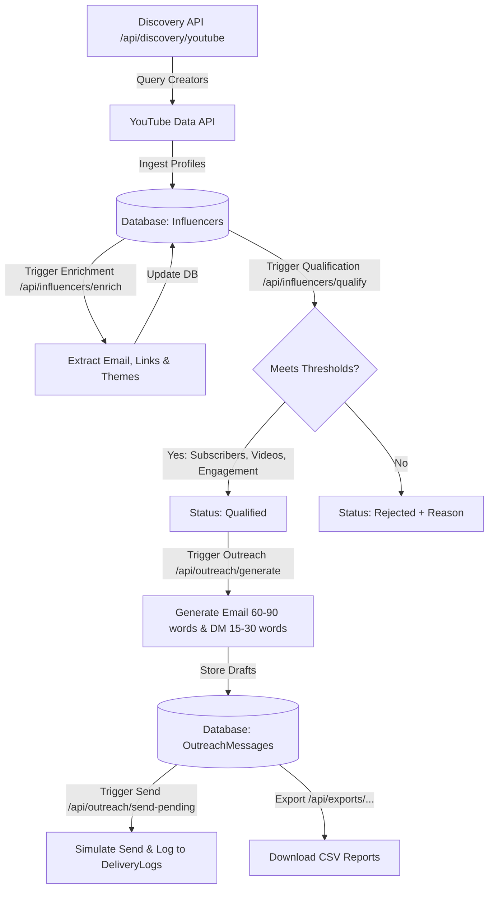

# EDXSO Influencer Outreach Platform

An AI-powered influencer discovery, qualification, enrichment, and personalized outreach backend service. Built with **FastAPI**, **SQLAlchemy**, and **SQLite**, the system integrates with the **YouTube Data API v3** to discover creators, assess engagement, personalize outreach copy (Email and Instagram DMs), simulate sending, and export campaign data.

---

## Table of Contents

- [Features](#features)
- [System Architecture](#system-architecture)
- [End-to-End Workflow](#end-to-end-workflow)
- [Tech Stack](#tech-stack)
- [Getting Started](#getting-started)
  - [Prerequisites](#prerequisites)
  - [Installation](#installation)
  - [Environment Configuration](#environment-configuration)
  - [Running the Server](#running-the-server)
- [API Reference](#api-reference)
  - [Health & Root](#health--root)
  - [Discovery & Influencers](#discovery--influencers)
  - [Enrichment & Qualification](#enrichment--qualification)
  - [Outreach Generation & Dispatch](#outreach-generation--dispatch)
  - [CSV Exports](#csv-exports)
- [Message Generation Specs](#message-generation-specs)
- [Directory Structure](#directory-structure)
- [Testing & Quality Assurance](#testing--quality-assurance)

---

## Features

- **Automated YouTube Discovery**: Search and ingest fitness and wellness creators directly via the YouTube Data API v3.
- **Smart Duplicate Prevention**: Unique URL constraints guarantee channels and profiles are never duplicated across workflows.
- **Channel Enrichment**: Extracts contact emails, public website links, and maps channel descriptions to inferred content themes (e.g. *Workout and Training*, *Nutrition and Diet*, *Weight Management*, *Yoga and Wellness*, *Sports and Performance*).
- **Rule-Based Qualification Engine**: Filters candidates according to customizable thresholds for subscriber counts, recent video uploads, and active engagement rates.
- **Personalized Multi-Channel Copywriting**:
  - **Email Outreach**: Professional, personalized pitches dynamically tailored to creator themes and niche, strictly bounded to **60–90 words**.
  - **Instagram DMs**: High-converting, direct collaboration invites strictly bounded to **15–30 words**.
- **Safe Dispatch & Simulation Mode**: Includes duplicate send prevention, draft state management (`Draft`, `Sent`, `Failed`), and simulated delivery logs.
- **One-Click CSV Exports**: Direct endpoints to download influencers, message drafts, and delivery audit logs for reporting or external CRM sync.

---

## System Architecture

```
                  ┌───────────────────────────────────────────────┐
                  │           FastAPI Application Router          │
                  └───────────────────────┬───────────────────────┘
                                          │
            ┌─────────────────────────────┼────────────────────────────┐
            ▼                             ▼                            ▼
  ┌───────────────────┐         ┌───────────────────┐        ┌───────────────────┐
  │ YouTube Provider  │         │  Business Logic   │        │   Export Engine   │
  │ (Data API v3)     │         │    & Pipeline     │        │  (Streaming CSV)  │
  └─────────┬─────────┘         └─────────┬─────────┘        └─────────┬─────────┘
            │                             │                            │
            │   ┌─────────────────────────┴────────────────────────┐   │
            │   ▼                         ▼                        ▼   │
            │ ┌───────────────┐  ┌──────────────────┐  ┌───────────────┴─┐
            │ │ Discovery &   │  │ Qualification &  │  │ Outreach &      │
            │ │ Enrichment    │  │ Rejection Logic  │  │ Delivery Audit  │
            │ └───────┬───────┘  └────────┬─────────┘  └───────┬─────────┘
            │         │                   │                    │
            ▼         ▼                   ▼                    ▼
      ┌──────────────────────────────────────────────────────────────┐
      │             SQLAlchemy ORM (SQLite Database)                 │
      │  [Influencers]  [OutreachMessages]  [DeliveryLogs]           │
      └──────────────────────────────────────────────────────────────┘
```

---

## End-to-End Workflow



---

## Tech Stack

| Component | Technology | Description |
| :--- | :--- | :--- |
| **Framework** | [FastAPI](https://fastapi.tiangolo.com/) (0.162+) | High-performance ASGI Python web framework |
| **Server** | [Uvicorn](https://www.uvicorn.org/) | Lightning-fast ASGI web server |
| **ORM** | [SQLAlchemy 2.0](https://www.sqlalchemy.org/) | Robust SQL database mapper and query builder |
| **Validation** | [Pydantic v2](https://docs.pydantic.dev/) | Strict data schema validation and serialization |
| **Database** | SQLite3 | Local zero-configuration relational storage |
| **External API** | YouTube Data API v3 | Creator metadata, subscriber statistics, and video metrics |
| **HTTP Client** | [HTTPX](https://www.python-httpx.org/) | Async HTTP requests for external provider integration |

---

## Getting Started

### Prerequisites

- **Python 3.12+** installed on your machine
- A valid **Google Cloud YouTube Data API v3 Key**

### Installation

1. **Clone the repository and navigate to the backend:**
   ```bash
   cd c:\projects\edxso\edxso-influencer-outreach\backend
   ```

2. **Create and activate a virtual environment:**
   - **Windows (PowerShell):**
     ```powershell
     python -m venv venv
     .\venv\Scripts\Activate.ps1
     ```
   - **Linux / macOS:**
     ```bash
     python3 -m venv venv
     source venv/bin/activate
     ```

3. **Install dependencies:**
   ```bash
   pip install -r requirements.txt
   ```

### Environment Configuration

Create a `.env` file inside the `backend` directory (or modify the existing one):

```env
APP_NAME="EDXSO Influencer Outreach"
DATABASE_URL=sqlite:///./influencer_outreach.db
OUTREACH_MODE=simulation

# YouTube API Configuration
YOUTUBE_API_KEY=YOUR_YOUTUBE_DATA_API_KEY_HERE

# Qualification Criteria
MIN_FOLLOWERS=1000
MAX_FOLLOWERS=100000
MIN_ENGAGEMENT_RATE=2.0
MIN_RECENT_VIDEOS=3
```

### Running the Server

Start the FastAPI application with live hot-reloading:

```bash
uvicorn app.main:app --reload
```

The server will be available at:
- **API Root**: [http://127.0.0.1:8000/](http://127.0.0.1:8000/)
- **Interactive Swagger Docs**: [http://127.0.0.1:8000/docs](http://127.0.0.1:8000/docs)
- **ReDoc Documentation**: [http://127.0.0.1:8000/redoc](http://127.0.0.1:8000/redoc)

---

## API Reference

### Health & Root

| Method | Endpoint | Description |
| :--- | :--- | :--- |
| `GET` | `/` | API status and welcome banner |
| `GET` | `/health` | Service health status check |

---

### Discovery & Influencers

#### 1. Discover YouTube Creators
- **`POST /api/discovery/youtube`**
- **Query Parameters**:
  - `target` (*int, default 50, range 1–500*): Number of creator channels to discover.
- **Sample Response**:
  ```json
  {
    "requested": 50,
    "discovered": 50,
    "inserted": 48,
    "duplicates_skipped": 2,
    "message": "Discovery completed. Review the records and their available metrics before qualification."
  }
  ```

#### 2. Create Influencer Manually
- **`POST /api/influencers`** (Status `201 Created`)
- **Body**:
  ```json
  {
    "name": "Jane Doe Fitness",
    "platform": "YouTube",
    "profile_url": "https://www.youtube.com/channel/UC1234567890",
    "follower_count": 25000,
    "engagement_rate": 3.8,
    "category": "Fitness & Nutrition",
    "content_themes": "Workout routines, meal preps",
    "contact_email": "jane@example.com",
    "website": "https://janefit.com",
    "geography": "United States",
    "source_url": "https://www.youtube.com/channel/UC1234567890"
  }
  ```

#### 3. List Influencers
- **`GET /api/influencers`**
- Returns an array of stored influencer profiles.

#### 4. Get Influencer By ID
- **`GET /api/influencers/{influencer_id}`**
- Returns detailed profile information for a specific influencer.

---

### Enrichment & Qualification

#### 1. Enrich Influencers
- **`POST /api/influencers/enrich`**
- Inspects channel metadata via YouTube API to extract public contact emails, external website links, and inferred content themes.
- **Sample Response**:
  ```json
  {
    "processed": 50,
    "enriched": 46,
    "needs_review": 4,
    "results": [...]
  }
  ```

#### 2. Qualify Influencers
- **`POST /api/influencers/qualify`**
- Validates pending influencers against configured subscriber thresholds (`1K`–`100K`), engagement rate (`>= 2.0%`), and recent uploads (`>= 3` videos). Sets status to `Qualified` or `Rejected`.
- **Sample Response**:
  ```json
  {
    "processed": 50,
    "qualified": 18,
    "rejected": 32,
    "results": [...]
  }
  ```

---

### Outreach Generation & Dispatch

#### 1. Generate Outreach Drafts
- **`POST /api/outreach/generate`**
- Automatically generates personalized **Email** and **Instagram DM** drafts for all influencers marked as `Qualified`.
- Skips already-generated drafts to avoid duplication.
- **Sample Response**:
  ```json
  {
    "qualified_influencers": 5,
    "drafts_generated": 10,
    "existing_drafts_skipped": 0,
    "messages_sent": 0,
    "results": [...]
  }
  ```

#### 2. View Stored Drafts
- **`GET /api/outreach/drafts`**
- Returns all stored drafts, including channel, subject line, message text, word count, and draft status.

#### 3. Send Single Outreach Message (Simulated)
- **`POST /api/outreach/send/{message_id}`**
- Simulates message delivery, changes status from `Draft` to `Sent`, and logs a delivery audit record. Prevents duplicate sending.

#### 4. Send All Pending Outreach (Simulated)
- **`POST /api/outreach/send-pending`**
- Batch processes all pending drafts in `Draft` or `Failed` status.

#### 5. View Delivery Logs
- **`GET /api/outreach/delivery-logs?message_id={optional_id}`**
- Returns execution logs and timestamps for all simulated outreach dispatches.

---

### CSV Exports

Direct CSV file downloads with UTF-8 encoding and standard HTTP attachments:

| Endpoint | Downloaded Filename | Contents |
| :--- | :--- | :--- |
| `GET /api/exports/influencers.csv` | `influencers.csv` | Full influencer roster, qualification status, and metrics |
| `GET /api/exports/outreach-messages.csv` | `outreach_messages.csv` | All generated Email & DM drafts with status |
| `GET /api/exports/delivery-logs.csv` | `delivery_logs.csv` | Complete delivery audit trial and timestamped events |

---

## Message Generation Specs

Outreach messages adhere to strict formatting and length constraints to maximize creator response rates while preventing spam flags:

### 1. Email Drafts
- **Target Channel**: `Email`
- **Subject**: `"Potential creator collaboration"`
- **Strict Word Count Constraint**: **60–90 words**
- **Personalization Variables**:
  - Creator's Name (e.g. `Hi Sameer,`)
  - Content Themes (mapped cleanly to concise phrases like `Workout and Training, Nutrition and Diet`)
  - Category / Niche (e.g. `Fitness`)
- **Tone**: Warm, professional, concise partnership proposal with a clear call-to-action.

### 2. Instagram DM Drafts
- **Target Channel**: `Instagram DM`
- **Subject**: `None`
- **Strict Word Count Constraint**: **15–30 words**
- **Tone**: Direct, conversational social media inquiry.

---

## Directory Structure

```
backend/
├── app/                         # FastAPI application, models, services & routes
│   ├── models/                  # SQLAlchemy ORM models (Influencer, OutreachMessage, DeliveryLog)
│   ├── providers/               # YouTube Data API v3 provider
│   ├── schemas/                 # Pydantic schemas
│   └── services/                # Discovery, enrichment, qualification, outreach & export services
├── tests/                       # Automated pytest suite (100% endpoint coverage)
│   ├── conftest.py              # In-memory SQLite fixtures and test client
│   └── test_api.py              # End-to-end API integration tests
├── .env                         # Environment configuration
└── requirements.txt             # Python dependencies

frontend/
├── index.html                   # Command Center UI layout
├── index.css                    # Glassmorphism dark design system
├── app.js                       # Real-time state management and API integration
├── vite.config.js               # Vite dev server configuration
└── package.json                 # Frontend scripts and dependencies
```

---

## Testing & Quality Assurance

- **Validation Checks**: Built-in word count validators ensure all generated copies strictly satisfy communication platform length limits.
- **SQLAlchemy Rollback Handling**: Database operations wrap in explicit `try/except` rollback blocks to maintain database integrity on failure.
- **Graceful API Error Handling**: Channel retrieval failures (e.g. private channels or quota spikes) gracefully flag records as `Needs Review` without interrupting the discovery batch.
